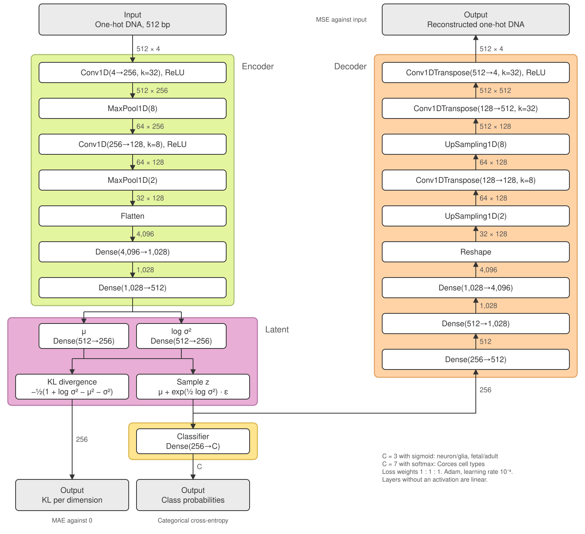

# vae

PyTorch port of the variational autoencoder (VAE) classifiers of brain cCREs (b-cCREs) from Pratt et al. 2024.



## Description

Pratt et al. trained VAEs to show how well DNA sequence alone separates subsets of b-cCREs. Each model encodes 512 bp of one-hot DNA around a b-cCRE center into a 256-dimensional latent space. A classifier head on the sampled latent vector trains jointly with the reconstruction and KL losses. A UMAP of the latent means then shows how the classes separate. There are three models:

| Notebook | Classes |
| --- | --- |
| `notebooks/neuron_glia.py` | neuron, glia, shared |
| `notebooks/fetal_adult.py` | fetal, adult, shared |
| `notebooks/cell_type_specific.py` | 7 Corces et al. 2020 brain cell types |

The model and notebooks port Greg Andrews's TensorFlow 2.8 notebooks from the paper's [Zenodo record](https://zenodo.org/records/10605867) to PyTorch and marimo. The original 3-class heads end in a sigmoid and the 7-class head in a softmax. Keras trains both as softmax cross-entropy on the logits. Every head here returns logits and trains the same way. The shared code is in `src/vae/`. `model.py` holds the PyTorch model and its loss. `training.py` holds a plain training loop that mirrors Keras's `fit` with a 10% validation split. UMAP runs on the GPU with cuML when one is available.

## Getting Started

### Dependencies

* Linux with an NVIDIA GPU and a driver for CUDA 13.0 or later. Training and UMAP fall back to the CPU without one.
* [uv](https://docs.astral.sh/uv/) and [just](https://just.systems/).
* Access to the Weng lab servers. The notebooks read labels from `/data/projects/psychSCREEN/Zenodo/code/VAE` and the genome from `/data/common/genome/hg38.fa`.

### Installing

```
git clone https://github.com/ramirc0/vae.git
cd vae
uv sync --extra gpu
```

### Executing program

* Open a notebook in marimo:
```
just edit notebooks/neuron_glia.py
```
* Click **Train** to fit the model. Weights for each epoch go to `checkpoints/<model>/` as safetensors files. The loss history goes to `results/<model>/history.csv`, and its learning curves to `results/<model>/learning-curves.svg`, one panel per metric.
* Or train from the command line:
```
just run notebooks/neuron_glia.py --train
```
* The notebook loads the epoch the original notebook used and writes the UMAP to `results/<model>/`. The repository includes those three checkpoints, so the notebooks run without training. Training overwrites them.
* Redraw the architecture diagram:
```
uv run --extra gpu python scripts/architecture.py results/architecture.svg
```

## Help

Pass `--extra gpu` to every `uv run` and `uv sync`. Without it, uv removes cuML from the environment. On a shared host, pick idle GPUs with `CUDA_VISIBLE_DEVICES`. Check what PyTorch sees with:
```
uv run --extra gpu python -c "import torch; print(torch.cuda.is_available(), torch.cuda.device_count())"
```

## Authors

Christian Ramirez, christian.ramirez1@umassmed.edu

The original model and notebooks are by Gregory Andrews.

## Acknowledgments

Pratt HE, Andrews G, Shedd N, et al. Using a comprehensive atlas and predictive models to reveal the complexity and evolution of brain-active regulatory elements. *Sci Adv* 10, eadj4452 (2024). https://doi.org/10.1126/sciadv.adj4452
